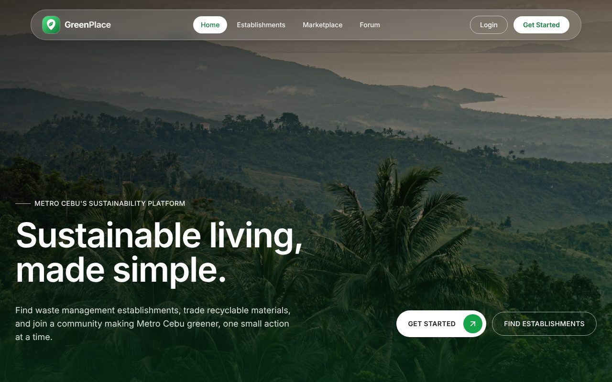
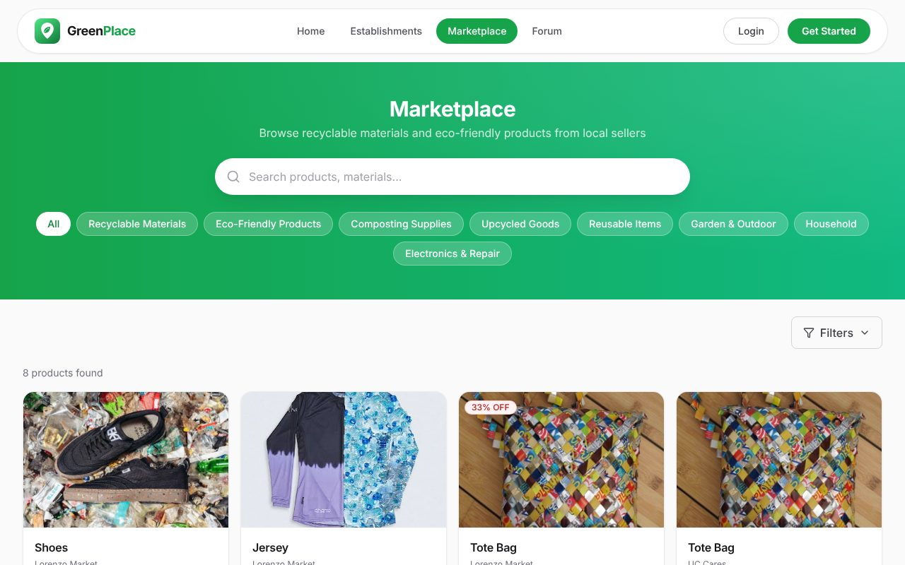
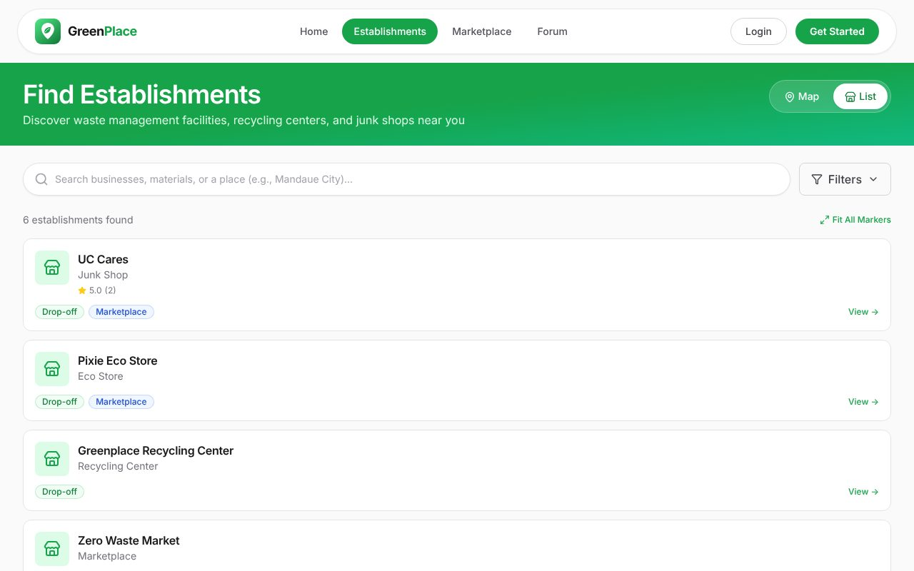
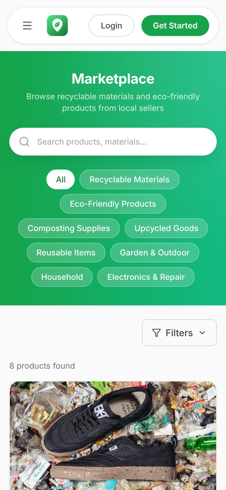
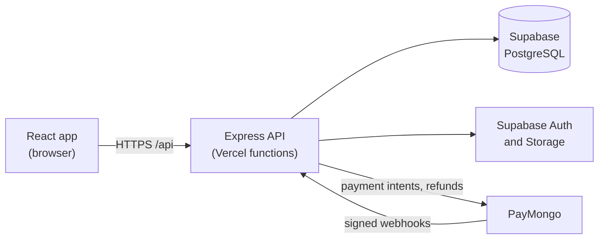

# GreenPlace

**A full-stack marketplace and community platform that helps people in Metro Cebu recycle, find waste-management shops, and buy and sell eco-friendly goods.**

[**Live demo →**](https://greenplace-three.vercel.app) &nbsp;·&nbsp; [System diagrams](docs/DIAGRAMS.md) &nbsp;·&nbsp; [Test plan and results](docs/TEST-PLAN.md)




---

## Why I built it

Recycling in Metro Cebu is hard to act on. Junk shops and recycling centers are scattered and hard to find, there is no single place to trade recyclable materials, and people who want to live more sustainably have nowhere to share what works.

I built GreenPlace to put all of that in one place: a map of waste-management establishments, a marketplace for recyclables and eco products, drop-off tracking, and a community forum. I designed and built it on my own, from the database to the deployment. It started as my capstone project, and I kept developing it into a production-style app with real payments, role-based access, and an end-to-end test plan.

## What it does

| For residents | For businesses | For admins |
|---|---|---|
| Find junk shops and recycling centers on a map | Apply with business documents for verification | Approve businesses after reviewing their documents |
| Buy recyclables and eco products, pay with GCash, Maya or cash on pickup | List products and manage stock | Approve or reject new listings with feedback |
| Track drop-offs and download receipts | Process orders and walk-in sales | Moderate the forum and handle user reports |
| Join the forum, message shops, leave reviews | See sales analytics and reply to reviews | Suspend accounts and manage platform settings |

<table>
  <tr>
    <td width="50%"></td>
    <td width="50%"></td>
  </tr>
  <tr>
    <td align="center"><sub>Marketplace</sub></td>
    <td align="center"><sub>Establishment directory (map and list views)</sub></td>
  </tr>
</table>

<p align="center"><br><sub>Fully responsive on phones</sub></p>

## Engineering highlights

The parts I'm proudest of are the ones you can't see in a screenshot.

**Stock that can't be oversold.** Stock is reserved the moment an order is placed, for every payment method, using an atomic compare-and-swap update. Each order carries a `stock_reserved` flag that is flipped atomically before stock is taken or returned, so a payment webhook and a status check arriving at the same time can never double-count. Unpaid online orders release their stock after 30 minutes, so abandoned checkouts can't lock items forever.

**Real payment integration.** GCash and Maya payments run through PayMongo payment intents. The server verifies every webhook signature, records each event once (so retries are safe), and also confirms payments directly with PayMongo when a buyer returns before the webhook arrives. Refunds go back through PayMongo and restore stock.

**Layered roles and moderation.** Users are residents, businesses or admins, enforced by server-side middleware and Supabase Row Level Security. Becoming a business never removes resident features. Businesses must upload DTI/SEC, permit and BIR documents (stored in a private bucket behind short-lived signed links) and pass admin review. New listings go through admin approval, and a database rule stops users from changing their own role.

**Built for real use.** Suspended accounts keep read-only access instead of being locked out, auth routes are rate-limited, and the API sits behind Helmet security headers and strict CORS. The whole app works on phone screens.

## Testing and what I learned

I wrote a **[64-procedure test plan](docs/TEST-PLAN.md)** covering every module and ran it end to end against the live deployment, using temporary test accounts and PayMongo test mode, then cleaned up all test data.

Testing the real deployment found bugs that never showed up on my laptop:

- **Logging out signed out a different user.** The server shared one Supabase client across all requests, and logout revoked whichever session was stored on it last. I fixed it so logout revokes only the caller's own token.
- **A database filter failed silently.** A `LIKE` filter on a Postgres enum column threw an error that the code ignored, so unpaid orders were never auto-cancelled. I replaced it with an explicit list and made query errors visible in the logs.
- **The payment page and the webhook disagreed.** I tested the case where a buyer closes the tab before returning to the site, to prove the webhook alone can confirm a payment.

The lesson I took away: testing against the live system, with real network paths and real third-party services, catches a class of bugs that local testing can't.

## How I built it

I built GreenPlace with AI-assisted development, using Claude Code as a pair programmer for implementation, debugging and testing. I owned the product decisions, the architecture and the review of every change. Working this way taught me how to direct an AI agent well: give it clear goals, check its work against the live system, and catch it when it is wrong.

## Architecture



The browser never talks to the database directly. Every read and write goes through the API, which checks the login token and the user's role first. Full data flow diagrams (levels 0 to 2), the network model and the network topology are in [docs/DIAGRAMS.md](docs/DIAGRAMS.md).

| Layer | Tools |
|---|---|
| Frontend | React 19, Vite, Tailwind CSS, React Router, Axios, Leaflet and OpenStreetMap, Recharts |
| Backend | Node.js, Express 5, Helmet, express-rate-limit, Multer |
| Data | Supabase PostgreSQL (Row Level Security), Supabase Auth, Supabase Storage |
| Payments | PayMongo (GCash, Maya), cash on pickup |
| Hosting | Vercel (client and API as one project), Supabase |

## Try it

Open the [live demo](https://greenplace-three.vercel.app) and register as a resident. Payments run in **PayMongo test mode**, so no real money moves: choose GCash at checkout and click "Authorize Test Payment" on the PayMongo page.

## Run it locally

**You need:** Node.js 18+, a free Supabase project, and a PayMongo account in test mode.

1. Copy the environment files and fill them in:

   ```bash
   cp server/.env.example server/.env
   ```

   ```bash
   cp client/.env.example client/.env
   ```

   | Variable | Where | Notes |
   |---|---|---|
   | `SUPABASE_URL`, `SUPABASE_ANON_KEY`, `SUPABASE_SERVICE_ROLE_KEY` | server | The service role key is server-only; never expose it to the client |
   | `PAYMONGO_SECRET_KEY`, `PAYMONGO_WEBHOOK_SECRET` | server | Use `sk_test_` keys only. `/api/health` shows which mode is running |
   | `CLIENT_URL` | server | Allowed CORS origin and redirect base; required in production |
   | `NODE_ENV` | server | `production` when deployed |
   | `VITE_API_URL` | client | API base URL including `/api` |

2. In Supabase, run the SQL files in `database/migrations/` in numeric order (001 to 033). They create the tables, Row Level Security policies and storage buckets. Optionally run `database/seeds/demo_data.sql` for sample shops, listings and forum posts.

3. Start the API (runs on http://localhost:3001):

   ```bash
   cd server && npm install && npm run dev
   ```

4. Start the web app (runs on http://localhost:5173):

   ```bash
   cd client && npm install && npm run dev
   ```

5. For payments, add a PayMongo **test-mode** webhook pointing to `https://<your-api>/api/payments/webhook` with the events `payment.paid` and `payment.failed`, and put its signing secret in `PAYMONGO_WEBHOOK_SECRET`.

**Checks:** `cd client && npm run lint && npm run build` for the frontend. `cd server && npm test` runs the API integration suite against a running server.

**Deploying:** see [docs/DEPLOY.md](docs/DEPLOY.md) for the full Vercel and Supabase setup.

## About me

I'm **Mael Lau**, building toward a career in AI engineering. GreenPlace is where I practiced shipping a real product end to end: designing the system, integrating payments, testing against production, and fixing what broke.

[GitHub @laumael9-hue](https://github.com/laumael9-hue)

---

<sub>Solo project by Mael Lau. Started as a capstone project. Educational use.</sub>
