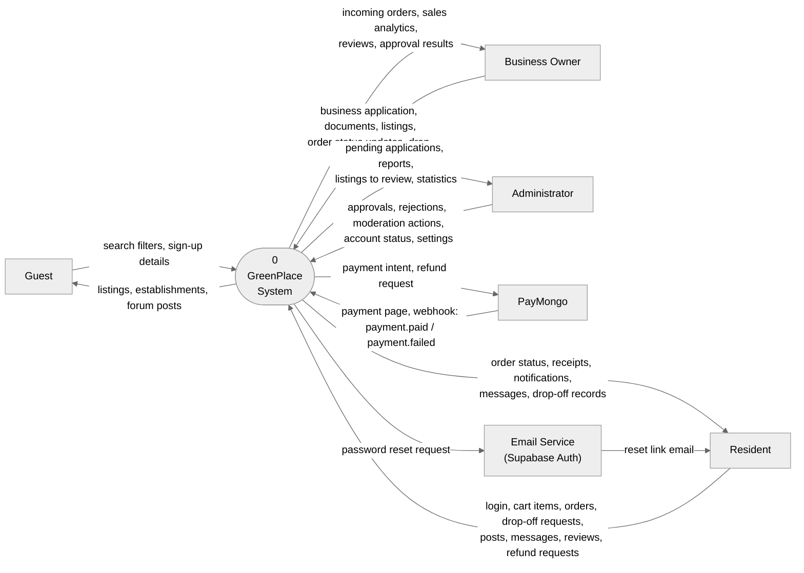
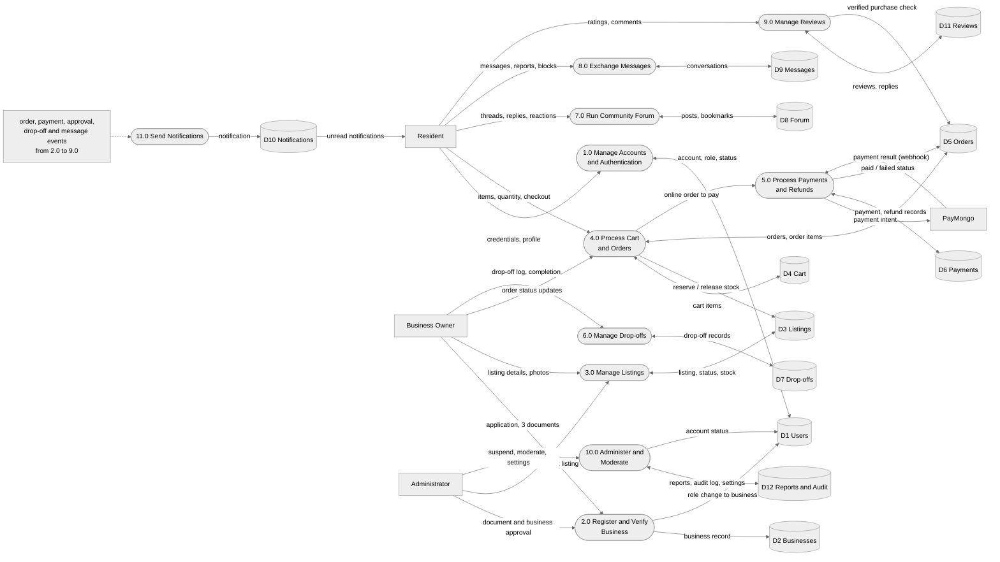
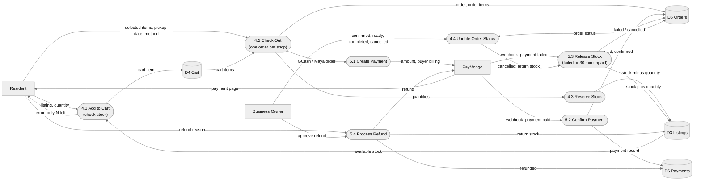
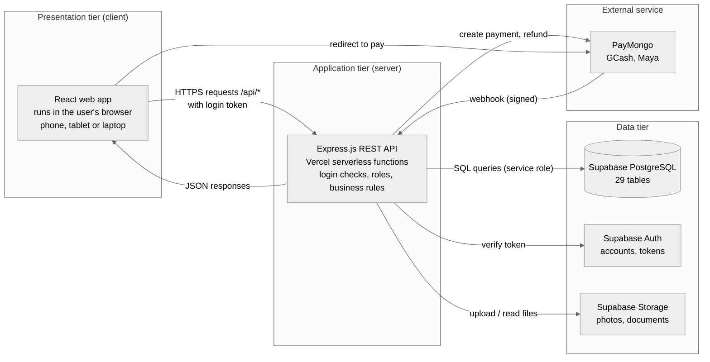
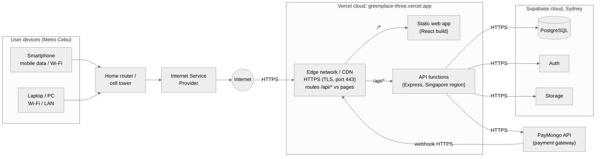

# GreenPlace System Diagrams

Data flow diagrams, network model and network topology for GreenPlace, drawn from the live system (React client and Express API on Vercel, Supabase, PayMongo).

**DFD notation:** rectangles are external entities, rounded boxes are processes, cylinders are data stores, and each arrow is labelled with the data that moves.

## Figure 1: Data Flow Diagram, Level 0 (Context Diagram)

**Figure 1.** Context diagram. Residents, business owners and administrators are separate entities because each sends and receives different data. A business owner keeps every resident capability (layered roles), so they also use the resident flows. PayMongo is external: GreenPlace never handles card or e-wallet credentials itself.

## Figure 2: Data Flow Diagram, Level 1

**Figure 2.** Level 1 DFD. Processes 4.0 and 5.0 carry the main business flow and are expanded in Figure 3. Every process writes through the API server, which is the only component allowed to change the data stores (Figure 4). The dotted input to 11.0 stands for the events that processes 2.0 to 9.0 raise (order placed, payment received, listing approved and so on); each becomes a notification in D10.

## Figure 3: Data Flow Diagram, Level 2: Ordering and Payment (Processes 4.0 and 5.0)

**Figure 3.** Level 2 DFD of ordering and payment. Stock is reserved when the order is placed (4.3), for every payment method, so the last unit cannot be sold twice. It is released when a payment fails, when an online order stays unpaid for 30 minutes, when an order is cancelled, or on refund (5.3, 5.4). If the buyer returns to the site before the webhook arrives, 5.2 also confirms the payment by asking PayMongo directly.

## Table 1: Data Stores and Their Database Tables

| Data store | Tables | Holds |
|---|---|---|
| D1 Users | `profiles` (+ Supabase Auth users) | Name, role (resident, business, admin), active status |
| D2 Businesses | `businesses`, `business_documents`, `business_hours`, `business_materials` | Shop profile, DTI/SEC, permit and BIR documents, hours, accepted materials and prices |
| D3 Listings | `listings`, `listing_images`, `categories` | Products, stock, status (draft, pending, active, rejected), photos |
| D4 Cart | `cart_items` | Items a resident intends to buy |
| D5 Orders | `orders`, `order_items` | Orders per shop, pickup schedule, status, stock-held flag |
| D6 Payments | `payments`, `refunds`, `webhook_events` | PayMongo payment IDs, refund records, processed webhook events |
| D7 Drop-offs | `drop_offs`, `drop_off_items` | Recyclables brought to shops, weights, estimated value |
| D8 Forum | `forum_threads`, `forum_posts`, `forum_reactions`, `forum_thread_reactions`, `forum_bookmarks` | Community posts, replies, reactions, saved posts |
| D9 Messages | `conversations`, `messages`, `conversation_settings` | Direct messages, mute, archive, block |
| D10 Notifications | `notifications` | In-app notifications and read status |
| D11 Reviews | `reviews` | Shop and product ratings, shop replies |
| D12 Reports and Audit | `reports`, `admin_audit_log`, `system_settings` | User and content reports, admin actions, platform settings |

Uploaded files (product photos, business documents, logos, avatars) are kept in Supabase Storage buckets, and their links are saved in the tables above.

## Figure 4: Network Model: Three-Tier Client–Server

**Figure 4.** GreenPlace follows a three-tier client–server model. The browser never talks to the database directly: every read and write goes through the API, which checks the login token and the user's role (resident, business or admin) first. Payment details stay with PayMongo; the API receives only the result, through a webhook signed with a shared secret.

## Figure 5: Network Topology

**Figure 5.** Network topology. User devices connect through their router or cell tower and ISP to the internet. Vercel's edge network receives all traffic over HTTPS and routes it: page requests to the static React app, and `/api/*` requests to the Express functions running in Singapore. Only the functions connect to Supabase in Sydney and to PayMongo, all over encrypted HTTPS. PayMongo calls back into the same edge address with its webhook. Overall this is a hub-and-spoke (star) layout with the API functions as the hub.
